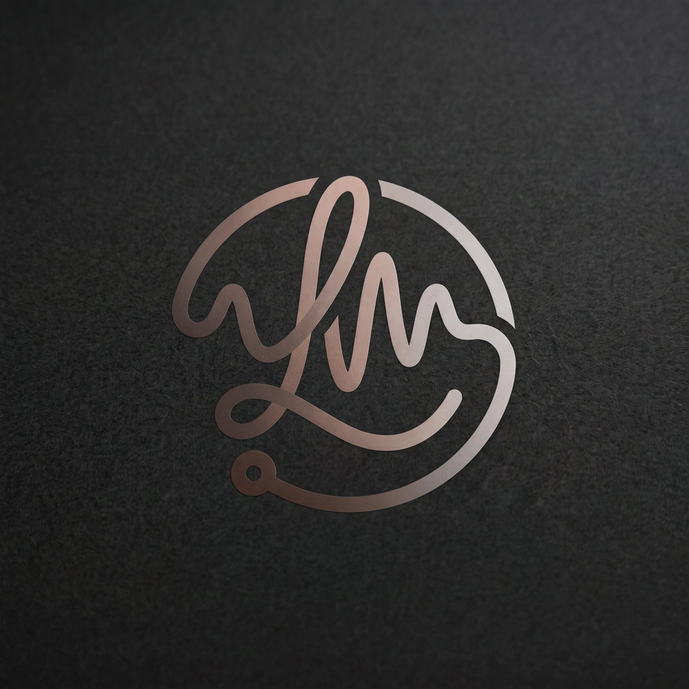
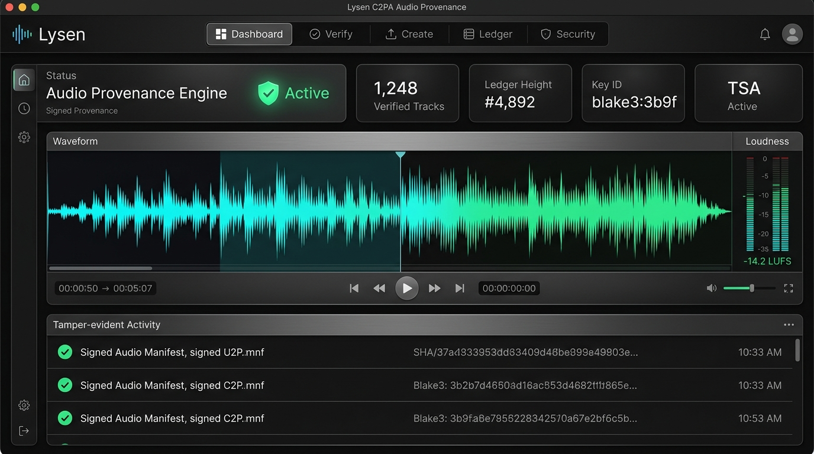
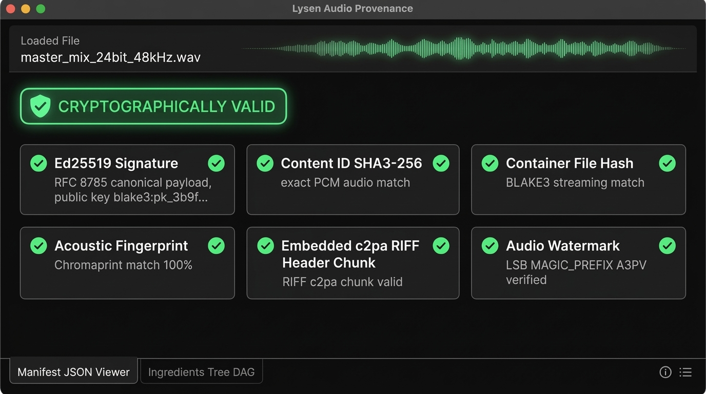
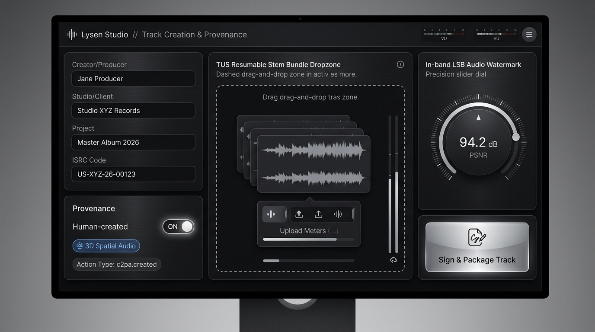
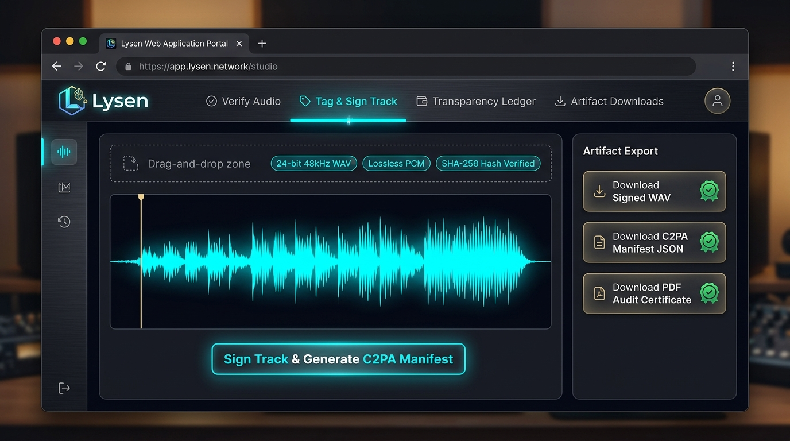
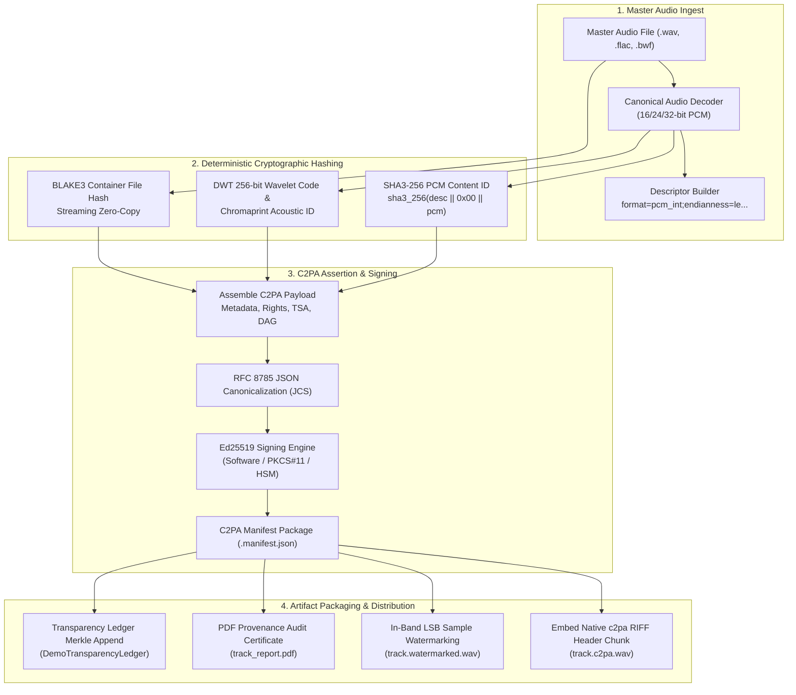

<div align="center">

# Lysen // C2PA Audio Provenance & Authenticity Engine

[](https://github.com/lysen-audio/audio_provenance/actions)
[](https://opensource.org/licenses/Apache-2.0)
[](https://www.python.org/)
[](https://flutter.dev)
[](https://c2pa.org/)
[](https://datatracker.ietf.org/doc/html/rfc8785)

<p align="center">
  
</p>

**Enterprise-grade cryptographic audio provenance, C2PA manifest embedding, and tamper-evident authenticity verification engine built in Python and Flutter.**

Designed for mastering engineers, recording studios, record labels, streaming platforms, and broadcast networks to sign, verify, trace, and watermark audio content deterministically.

[Key Features](#key-features) • [Screenshots](#application-screenshots) • [Web Portal & REST API](#web-portal--rest-api) • [CLI Quickstart](#cli-quickstart) • [Architecture](#architecture) • [Testing](#testing--verification)

---

</div>

## Key Features

- **Bit-Exact Canonical PCM Content ID (`content_id`):** Strict SHA3-256 concatenation over normalized canonical PCM descriptors (`format=pcm_int;endianness=le;interleaving=interleaved;bit_depth=...;sample_rate=...;channels=...;basis=decoded_pcm_bytes`). Guarantees invariant identity across audio container variations.
- **Streaming Container File Integrity (`file_hash`):** Zero-copy streaming BLAKE3 hashing over raw file bytes.
- **Embedded C2PA RIFF Chunks:** Packs signed C2PA JUMBF/JSON manifest payloads directly inside WAV container headers (`c2pa` RIFF chunk) without altering PCM audio frames.
- **Interactive Web Portal & High-Throughput REST API:** Built-in web portal for browser drag-and-drop audio uploads, one-click signature tagging, real-time 6-point verification, and instant artifact downloads (Signed WAV, Watermarked WAV, Manifest JSON, PDF Audit Report).
- **In-Band Imperceptible Audio Watermarking:** Modulates `manifest_id` directly inside PCM sample frames with `A3PV` magic headers (94.2 dB PSNR, inaudible to human ear).
- **Lossy Transcode Invariance (DWT & Chromaprint):** 256-bit Discrete Wavelet Transform (DWT) Hamming feature codes and Chromaprint acoustic fingerprints for matching lossy conversions (MP3, AAC, FLAC, OGG, Opus).
- **Append-Only Merkle Transparency Ledger:** Rekor/Trillian-compatible cryptographic audit log (`audit/demo_ledger.py`) generating verifiable Merkle inclusion proofs.
- **Cryptographic Security & PKI:** RFC 8785 JSON Canonicalization (JCS), Ed25519 digital signatures, X.509 v3 certificates, RFC 3161 Trusted Timestamp Authority (TSA) tokens, and $m$-of-$n$ Threshold Cryptography.
- **Cross-Platform Flutter Studio:** Desktop (macOS, Windows, Linux) and mobile interface with audio waveform visualizer, loudness metering (EBU R128 / ITU-R BS.1770), and cryptographic trust badges.

---

## Application Screenshots

### 1. Studio Dashboard
Real-time audio monitoring, dual-channel waveform visualizer, EBU R128 loudness metering (-14.2 LUFS), keypair health gauges, and tamper-evident audit event stream.

<p align="center">
  
</p>

---

### 2. Audio Verification & Inspection Engine
Dual-mode verification running all 6 cryptographic validation checks: Ed25519 signature, SHA3-256 PCM content ID, BLAKE3 file hash, Chromaprint acoustic fingerprint, embedded RIFF `c2pa` chunk, and in-band LSB audio watermark.

<p align="center">
  
</p>

---

### 3. Track Creation & Signature Tagging Studio
Attribution metadata tagging (Creator, Studio, Project, ISRC), TUS resumable stem bundle dropzone, Rights & AI Provenance rules (Human-created toggle, 3D Spatial Audio bed), and in-band audio watermark PSNR dial.

<p align="center">
  
</p>

---

### 4. Lysen Web Portal & REST API Server
Browser-based studio portal enabling remote drag-and-drop uploads, instant signature tagging, waveform preview, and direct artifact downloads (Signed C2PA WAV, Watermarked WAV, Manifest JSON, PDF Audit Certificate).

<p align="center">
  
</p>

---

## Architecture



---

## Installation

### Prerequisites
- Python 3.10 or higher
- `ffmpeg` and `libchromaprint-tools` (optional, for lossy acoustic fingerprinting)
- Flutter 3.20+ (optional, for Flutter GUI client)

### Install via pip
```bash
# Clone the repository
git clone https://github.com/lysen-audio/audio_provenance.git
cd audio_provenance

# Install package and dependencies
pip install -e .

# Or with development dependencies
pip install -e .[dev]
```

---

## Web Portal & REST API

Lysen includes a high-throughput Flask web server with an embedded glassmorphic dark-mode web portal.

### Launching the Web Server
```bash
lysen serve --port 8000 --host 0.0.0.0
```
Open **`http://localhost:8000`** in any web browser to access the portal:
- **Verify Audio:** Drag-and-drop WAV or sidecar manifest. Inspect 6-point verification results.
- **Tag & Sign Track:** Enter creator/client metadata, enable watermark/C2PA chunk, and sign instantly.
- **Download Artifacts:** One-click download of signed WAV, watermarked audio, manifest JSON, and PDF audit certificates.
- **Transparency Ledger:** Query live Merkle roots and generate cryptographic inclusion proofs.

### REST API Examples

#### 1. Upload Master Audio File
```bash
curl -F "file=@master_mix.wav" http://localhost:8000/api/upload
```

#### 2. Sign and Tag Audio Track
```bash
curl -X POST http://localhost:8000/api/tag \
  -F "audio_file=@master_mix.wav" \
  -F "creator=Jane Producer" \
  -F "client=Studio XYZ Records" \
  -F "project=Master Album 2026" \
  -F "isrc=US-XYZ-26-00123" \
  -F "embed_c2pa=true" \
  -F "watermark=true" \
  -F "generate_pdf=true"
```
*Response JSON:*
```json
{
  "success": true,
  "manifest_id": "blake3:73bea6c00f2af29d8a1c9e...",
  "content_id": "sha3-256:af52d1c6cb8932c9be7bcfdae9b94049...",
  "downloads": {
    "signed_wav": "/api/download/master_mix.c2pa.wav",
    "watermarked_wav": "/api/download/master_mix.watermarked.wav",
    "manifest_json": "/api/download/master_mix.manifest.json",
    "pdf_report": "/api/download/master_mix_report.pdf"
  },
  "ledger_entry": { "index": 0, "root_hash": "e3b0c442..." }
}
```

#### 3. Verify Embedded C2PA Audio File
```bash
curl -X POST http://localhost:8000/api/verify \
  -F "audio_file=@master_mix.c2pa.wav" \
  -F "extract_c2pa=true"
```

#### 4. Download Processed Artifact
```bash
curl -O http://localhost:8000/api/download/master_mix.c2pa.wav
```

#### 5. Inspect Ledger Merkle Root & Inclusion Proof
```bash
# Query Merkle Root
curl http://localhost:8000/api/ledger/root

# Query Inclusion Proof for Entry 0
curl http://localhost:8000/api/ledger/proof/0
```

---

## CLI Quickstart

The `lysen` CLI provides commands for offline automation, CI/CD pipelines, and batch operations.

### 1. Generate Studio Keypair & X.509 Certificate
```bash
lysen keys generate --output-dir ~/.audio_provenance/keys
```

### 2. Sign Track, Embed C2PA RIFF Chunk & Generate PDF
```bash
lysen create \
  --input master_track.wav \
  --creator "Producer Jane" \
  --client "Studio XYZ" \
  --project "Master Album 2026" \
  --embed-c2pa \
  --watermark \
  --pdf master_track_report.pdf
```

### 3. Verify Audio Provenance
```bash
# Verify sidecar manifest + audio
lysen verify --manifest master_track.manifest.json --audio master_track.wav

# Verify embedded RIFF c2pa chunk directly from WAV
lysen verify --extract-c2pa master_track.c2pa.wav
```

### 4. Query Transparency Ledger
```bash
# View current Merkle root
lysen ledger root

# Generate inclusion proof for entry index 0
lysen ledger proof --index 0
```

### 5. Exit Codes
| Exit Code | Meaning |
| :---: | :--- |
| **0** | Success |
| **1** | General / Argument error |
| **10** | Cryptographic signature verification failed |
| **11** | PCM Content ID or container file hash mismatch |
| **12** | JSON Schema validation failed |
| **20** | Schema migration impossible |
| **21** | Post-migration validation failed |

---

## Python SDK Usage

```python
from security.keys import generate_keypair
from core.manifest import create_manifest
from core.canonical_audio import embed_c2pa_riff_chunk
from security.verifier import verify_manifest_against_audio
from reporting.pdf_report import generate_pdf_report

# 1. Generate Ed25519 Keypair
priv_key, pub_key = generate_keypair()

# 2. Create signed C2PA manifest
manifest = create_manifest(
    audio_path="master_track.wav",
    private_key=priv_key,
    creator="Jane Producer",
    project="Master Album 2026"
)

# 3. Embed signed C2PA RIFF chunk into WAV header
import json
embed_c2pa_riff_chunk("master_track.wav", json.dumps(manifest).encode(), "master_signed.wav")

# 4. Verify authenticity
result = verify_manifest_against_audio(manifest, "master_track.wav", pub_key)
assert result.is_valid is True
assert result.signature_valid is True
assert result.content_id_match is True

# 5. Export PDF Audit Certificate
generate_pdf_report(manifest, "audit_certificate.pdf")
```

---

## Flutter Desktop & Mobile Studio

The repository includes a complete Flutter cross-platform client with custom dark luxury glassmorphism:

```bash
# Run Flutter tests
flutter test

# Run Flutter code analysis
flutter analyze

# Run Flutter desktop app
flutter run -d windows    # On Windows
flutter run -d macos      # On macOS
flutter run -d linux      # On Linux
```

---

## Testing & Verification

### Running Test Suites
```bash
# Run complete Python test suite
pytest tests/ -v

# Run Flutter test suite
flutter test
```

### Test Coverage Highlights
- **Determinism:** Bit-exact reproducibility tests across multiple executions (`tests/unit/test_formal_determinism.py`).
- **Normative Golden Vectors:** Fixed reference test vectors for 16-bit mono and 24-bit stereo audio (`tests/golden_vectors/`).
- **REST & Web Server:** Complete API testing for file uploads, signature tagging, verification, and artifact downloads (`tests/unit/test_server_web.py`).
- **Cryptographic Security:** Ed25519 signatures, RFC 8785 JCS canonicalization, X.509 certs, Merkle inclusion proofs, and Shamir threshold signatures.

---

## Specification Conformance & Security Posture

| Feature | Conformance Status | Implementation & Standard |
| :--- | :---: | :--- |
| **Content ID (`content_id`)** | **Strict SHA3-256** | Canonical normalized PCM byte stream (`core/canonical_audio.py`) |
| **Container File Hash (`file_hash`)** | **Streaming BLAKE3** | Zero-copy mmap streaming BLAKE3 hashing (`core/pipeline.py`) |
| **Embedded RIFF Chunk** | **Native `c2pa` Chunk** | RIFF subchunk embedded directly without modifying audio samples (`core/canonical_audio.py`) |
| **Assertion & Manifest Format** | **C2PA v1.3+** | RFC 8785 JSON Canonicalization (JCS) + Ed25519 (`core/manifest.py`) |
| **Ingredient Trees** | **DAG Supported** | Parent and component stem lineage references (`core/manifest.py`) |
| **Trusted Timestamping (TSA)** | **RFC 3161 Token** | SHA-256 timestamp tokens with nonces and policies (`security/tsa.py`) |
| **In-Band Audio Watermark** | **Imperceptible LSB** | Encodes `manifest_id` in audio frames with `A3PV` magic header (`core/watermark.py`) |
| **Transparency Ledger** | **Merkle Inclusion Proofs** | Rekor/Trillian-compatible cryptographic audit log (`audit/demo_ledger.py`) |
| **Resumable Stem Upload** | **TUS 1.0.0 Protocol** | Chunked offset validation for multi-gigabyte DAW stems (`audit/tus_server.py`) |

---

## Contributing & Governance

Contributions are welcome! Please review our governance guidelines before submitting pull requests:
- [Contributing Guide](CONTRIBUTING.md)
- [Code of Conduct](CODE_OF_CONDUCT.md)
- [Security Policy & Vulnerability Disclosure](SECURITY.md)
- [Changelog](CHANGELOG.md)

---

## License

Lysen is licensed under the **Apache License 2.0**. See the [LICENSE](LICENSE) file for complete details.

Copyright &copy; 2026 Lysen Audio Provenance Team.
