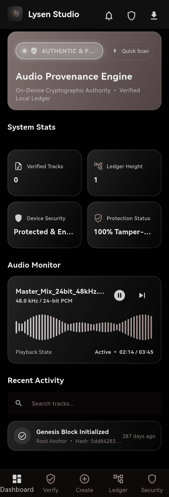
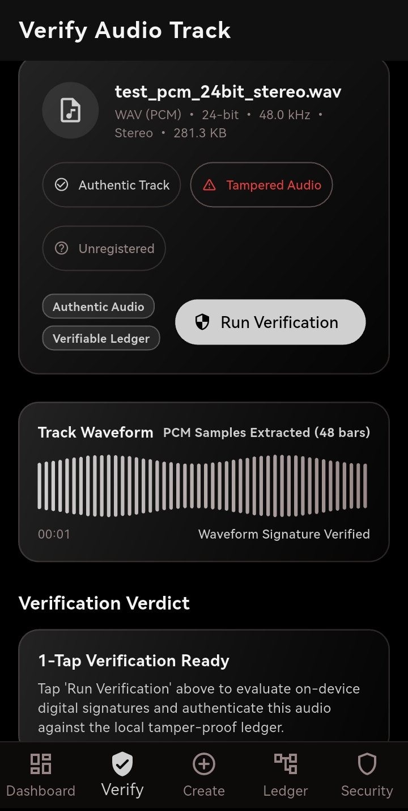
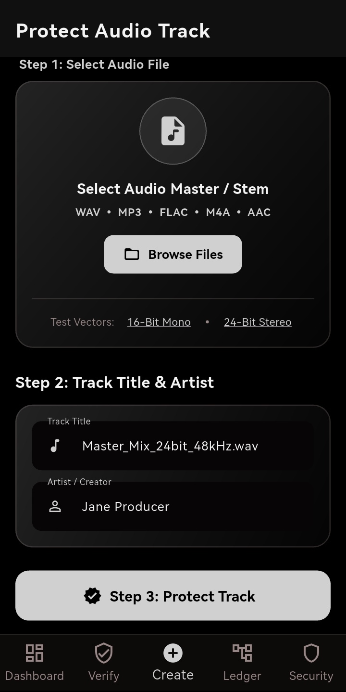
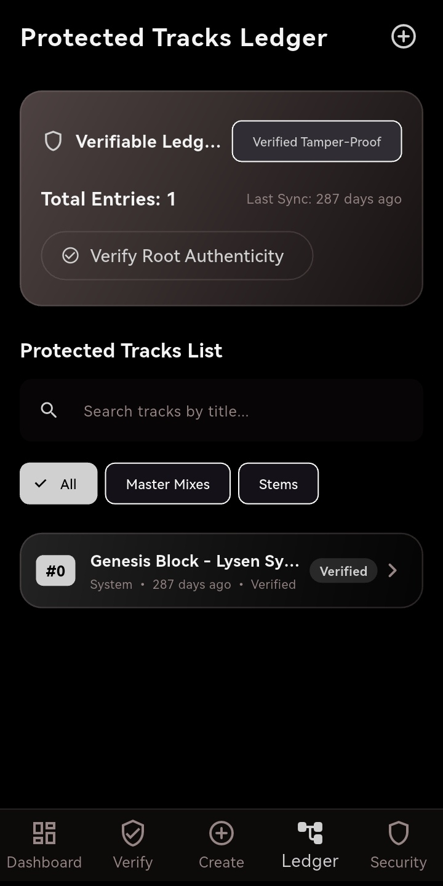
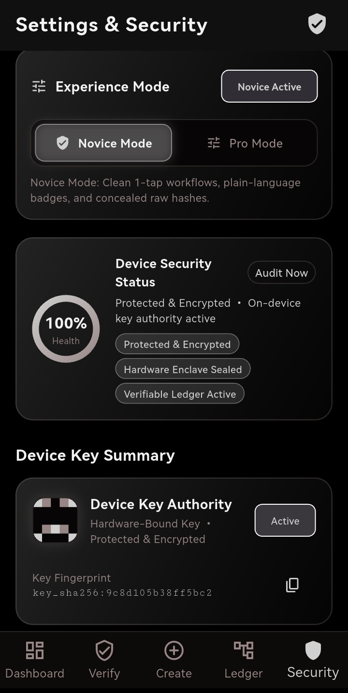

# Lysen — Audio Provenance & Authenticity

[](https://flutter.dev)
[](https://www.python.org/)
[](https://github.com/ChipulaCollins/Lysen_audio_provenance/actions/workflows/ci.yml)
[](LICENSE)

A Flutter application and Python toolkit for protecting audio, verifying digital signatures, and tracking provenance. Built for artists, producers, and studios who want a clear record of their audio's origin and integrity.

**Select a track → Add creator details → Protect → Verify.**

[Features](#features) · [Screenshots](#app-screenshots) · [Getting Started](#getting-started) · [Web Portal](#web-portal--rest-api) · [Documentation](#documentation)

---

## Features

- **Protect Audio**: Select a master or stem, add the track title and creator, and sign it on the device.
- **Verify Tracks**: Check audio against its registered signature and local ledger, with clear verification results.
- **Audio Inspection**: View file details and PCM waveforms, with built-in sample tracks for trying the workflow.
- **Novice & Pro Modes**: Switch between simple controls and detailed views of hashes, signatures, and ledger data.
- **Verifiable Ledger**: Browse protected tracks, search by title, and check the integrity of the local hash chain.
- **Python Provenance Toolkit**: Create signed manifests, embed them in WAV files, apply audio watermarks, and export PDF reports.
- **Web Portal & REST API**: Upload, sign, verify, and download audio artifacts through the included Flask server.

---

## App Screenshots

Actual screenshots from the Lysen app. Select an image to view it at full size.

### Dashboard, Verification & Protection

<div align="center">

| Studio Dashboard | Verify Audio | Protect Audio |
| :---: | :---: | :---: |
| <a href="assets/screenshots/01_dashboard.jpg"></a> | <a href="assets/screenshots/02_verify.jpg"></a> | <a href="assets/screenshots/03_protect_create.jpg"></a> |

</div>

### Ledger & Security

<div align="center">

| Protected Tracks Ledger | Settings & Security |
| :---: | :---: |
| <a href="assets/screenshots/04_ledger.jpg"></a> | <a href="assets/screenshots/05_settings_security.jpg"></a> |

</div>

---

## Tech Stack

| Component | Technology |
| :--- | :--- |
| App | Flutter, Dart, Material UI |
| Local signing | SHA-256, secp256k1 ECDSA |
| Local persistence | JSON ledger files, SharedPreferences |
| Python toolkit | Python 3.10+, NumPy, SoundFile |
| Manifest signing & integrity | Ed25519, SHA3-256, BLAKE3 |
| Web portal & API | Flask |
| Reports | ReportLab PDF generation |

The Flutter app handles its local signing and ledger workflow. The Python toolkit provides separate CLI and web workflows for audio manifests and reports.

---

## Getting Started

### Prerequisites

- **Flutter app**: Flutter 3.38.4+ with Dart 3.10.3+ for the current dependency lockfile, plus a configured device or emulator.
- **Python toolkit**: Python 3.10+ and pip.
- **Optional audio tools**: FFmpeg and Chromaprint (`fpcalc`) for acoustic fingerprinting.

### 1. Clone the Repository

```bash
git clone https://github.com/ChipulaCollins/Lysen_audio_provenance.git
cd Lysen_audio_provenance
```

### 2. Run the Flutter App

```bash
flutter pub get
flutter run
```

Choose your connected device or emulator when prompted. For the Windows desktop app, use `flutter run -d windows`.

To try the app, open **Create**, choose a bundled **16-Bit Mono** or **24-Bit Stereo** sample, add a title and creator, and tap **Protect Track**. Then open **Ledger** to see the record or **Verify** to check the track.

### 3. Install the Python Toolkit

From the repository root, create a virtual environment:

```bash
python -m venv venv
```

Activate it using the command for your shell:

```powershell
# Windows PowerShell
.\venv\Scripts\Activate.ps1
```

```bash
# macOS / Linux
source venv/bin/activate
```

Install the toolkit and development dependencies:

```bash
python -m pip install -e ".[dev]"
```

---

## CLI Quickstart

Create a signed manifest using a bundled sample, then verify it:

```bash
lysen create --input tests/golden_vectors/test_pcm_24bit_stereo.wav --output demo.manifest.json --creator "Your Name"
lysen verify --manifest demo.manifest.json --audio tests/golden_vectors/test_pcm_24bit_stereo.wav
```

The CLI generates a default signing key on first use. The manifest is saved as `demo.manifest.json`.

For your own WAV file, you can also embed the manifest and generate a report:

```bash
lysen create --input master.wav --creator "Your Name" --embed-c2pa --pdf master_report.pdf
lysen verify --extract-c2pa master.c2pa.wav
```

Use `lysen --help` for all commands, or see the [User Guide](docs/USER_GUIDE.md) for watermarking, key management, and ledger proofs.

---

## Web Portal & REST API

After installing the Python toolkit, start the local server:

```bash
lysen serve --host 127.0.0.1 --port 8000
```

Open **[http://localhost:8000](http://localhost:8000)** to upload audio, create signed manifests, verify tracks, and download generated artifacts.

| Endpoint | Purpose |
| :--- | :--- |
| `GET /api/health` | Check server status |
| `POST /api/upload` | Upload an audio file |
| `POST /api/tag` | Sign audio and generate artifacts |
| `POST /api/verify` | Verify audio and its manifest |
| `GET /api/download/<filename>` | Download a generated artifact |
| `GET /api/ledger/root` | Read the transparency ledger root |
| `GET /api/ledger/proof/<index>` | Retrieve an inclusion proof |

---

## Testing

Run the checks for the component you are working on:

```bash
# Flutter
flutter analyze
flutter test

# Python (with the virtual environment active)
python -m pytest tests/ -v
```

Reference audio and expected hashes are available in [tests/golden_vectors](tests/golden_vectors/README.md).

---

## Documentation

| Guide | Contents |
| :--- | :--- |
| [User Guide](docs/USER_GUIDE.md) | CLI commands and workflows |
| [API & Hashing Specification](docs/API.md) | Content IDs, manifest structure, and verification rules |
| [Capabilities & Limitations](docs/LIMITATIONS.md) | Audio formats and implementation boundaries |
| [Key Rotation](docs/KEY_ROTATION.md) | Managing signing identities |
| [Python Example](examples/basic_create_verify.md) | Create and verify a manifest in Python |
| [Studio Workflow](examples/studio_workflow.md) | A studio-oriented integration example |

## Contributing

Contributions are welcome. Read the [Contributing Guide](CONTRIBUTING.md) and [Code of Conduct](CODE_OF_CONDUCT.md) before opening a pull request. Report vulnerabilities through the [Security Policy](SECURITY.md).

See the [Changelog](CHANGELOG.md) for release notes.

## License

Licensed under the [Apache License 2.0](LICENSE).
