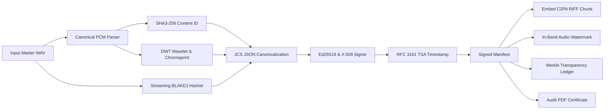

# Lysen User Guide & Workflow Manual

## 1. Overview & Architecture

Lysen is an enterprise-grade C2PA audio provenance platform designed to bind cryptographic identity, audit proofs, and perceptual audio fingerprints directly into sound masters, stems, podcasts, and broadcast feeds.



---

## 2. Command-Line Interface (CLI)

Lysen provides both the `lysen` command and `python -m cli` entrypoints.

### 2.1 Cryptographic Key Management & PKI
Generate an Ed25519 private key, public key, and self-signed X.509 certificate:
```bash
lysen keys generate --output-dir ~/.lysen/keys
```

Output files:
- `ed25519_priv.pem`: PKCS#8 private key
- `ed25519_pub.pem`: SubjectPublicKeyInfo PEM
- `x509_cert.pem`: X.509 v3 Digital Certificate

### 2.2 Create Signed Manifest & Embed Provenance
Sign an uncompressed audio master, embed a C2PA chunk directly into the WAV container, embed an in-band LSB watermark, append to the Merkle ledger, and generate an audit PDF:
```bash
lysen create \
  --input master_track.wav \
  --creator "Lead Mastering Engineer" \
  --client "Universal Soundworks" \
  --project "Symphony No. 9 2026 Remaster" \
  --software "Pro Tools 2026.3, Lysen Engine v1.0.0" \
  --embed-c2pa \
  --watermark \
  --pdf master_track_report.pdf
```

Created artifacts:
- `master_track.manifest.json`: Sidecar C2PA manifest.
- `master_track.c2pa.wav`: WAV container with embedded `c2pa` RIFF chunk.
- `master_track.watermarked.wav`: Audio with imperceptible LSB-embedded `manifest_id`.
- `master_track_report.pdf`: Printable cryptographic provenance certificate.

### 2.3 Verify Provenance & Integrity

#### A. Verify Sidecar Manifest against Master Audio
```bash
lysen verify --manifest master_track.manifest.json --audio master_track.wav
```

#### B. Verify Embedded RIFF C2PA Chunk Directly from WAV
```bash
lysen verify --extract-c2pa master_track.c2pa.wav
```

#### C. Verify with Custom Public Key
```bash
lysen verify --manifest master_track.manifest.json --audio master_track.wav --public-key path/to/pubkey.pem
```

#### D. Perceptual Lossy Derivative Verification
```bash
# Verifies transcode lineage for compressed files (MP3, AAC) via Chromaprint & DWT
lysen verify --manifest master_track.manifest.json --audio master_track.mp3 --perceptual
```

Exit Codes:
- `0`: Verification succeeded (Signature valid, bit-exact or perceptual match verified).
- `10`: Signature verification failed or tampered.
- `11`: Audio content / container hash integrity mismatch.
- `12`: Manifest schema validation failed.

### 2.4 DAW Export Watcher Daemon (Zero-Touch Auto-Signing)
Run Lysen as a background watcher over your studio DAW export folder:
```bash
lysen watch --dir ~/Music/Logic/Bounces --daw "Logic Pro"
```
Whenever a render finishes settling, Lysen automatically generates a signed manifest, logs the event, and embeds C2PA headers.

### 2.5 Permaweb Decentralized Storage Anchor
Anchor manifests to IPFS CIDv1 and Arweave permaweb:
```bash
lysen permaweb --manifest master_track.manifest.json
```

### 2.6 Transparency Ledger & Merkle Proofs
Inspect the cryptographic append-only transparency ledger (Rekor compatible):
```bash
# Query the current Merkle root of the ledger
lysen ledger root

# Generate and verify Merkle inclusion proof for entry index 0
lysen ledger proof --index 0
```

### 2.7 Perceptual DWT Wavelet Hashing
Compute transcode-invariant Discrete Wavelet Transform hash for lossy audio verification:
```bash
lysen wavelet --input master_track.wav
```

### 2.8 Spatial Audio Descriptors
Inspect spatial channel mappings and canonical descriptors for multi-channel arrays:
```bash
lysen spatial --channels 12 --sample-rate 48000 --bit-depth 24
```

### 2.9 System Diagnostics
Display runtime environment, fpcalc acoustic engine status, BLAKE3 acceleration, and recent audit events:
```bash
lysen info
```

---

## 3. Python API Integration

```python
from core.manifest import create_manifest
from security.keys import load_private_key
from security.verifier import verify_manifest_against_audio

# 1. Sign audio
priv_key = load_private_key("path/to/ed25519_priv.pem")
manifest = create_manifest(
    audio_path="vocal_track.wav",
    private_key=priv_key,
    creator="Jane Doe",
    client="Abbey Road Studios",
    project="Project Alpha",
)

# 2. Verify audio
result = verify_manifest_against_audio(manifest, "vocal_track.wav")
assert result.is_valid is True
assert result.signature_valid is True
assert result.content_id_match is True
```

---

## 4. Flutter Desktop & Mobile Studio

The Flutter application provides a visual dashboard for mastering engineers, dropzone stem bundle uploads, and hardware enclave management:
```bash
# Run Flutter Desktop/Web client
flutter run -d windows
```
